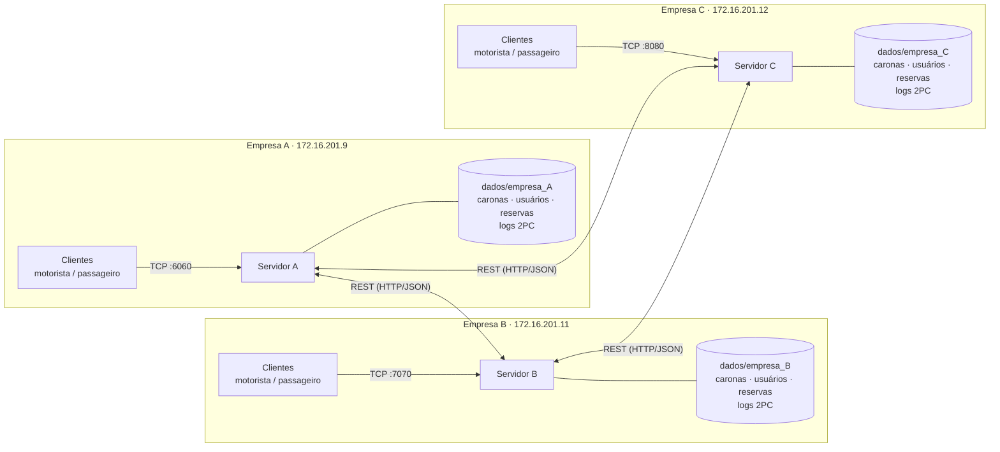
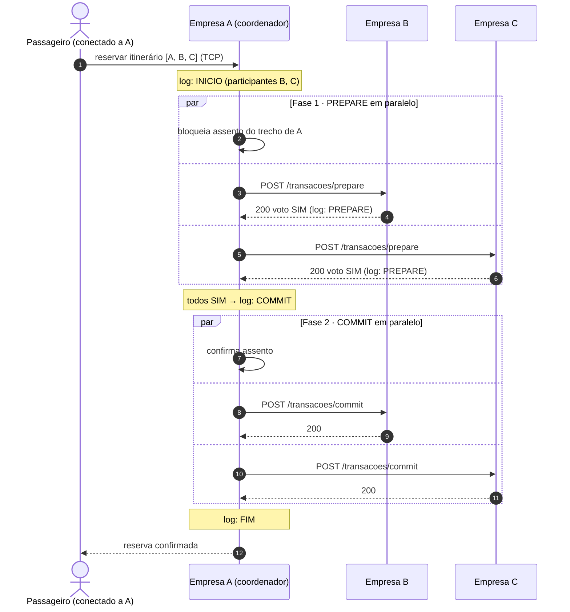
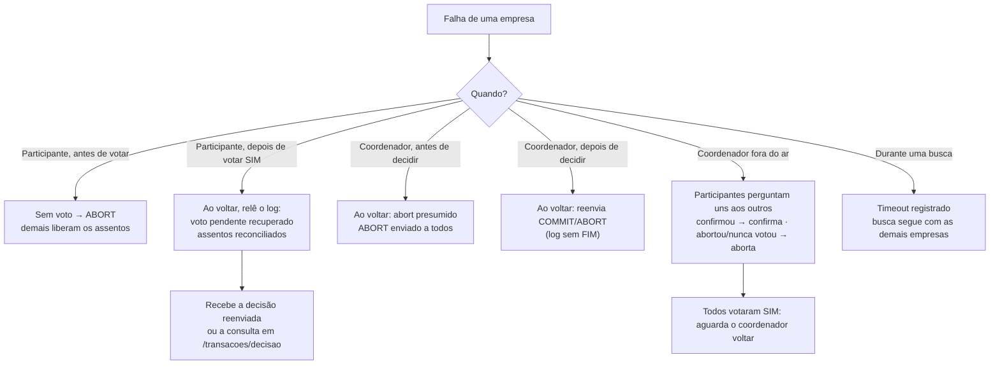

# VaiJunto — Consórcio de Caronas Compartilhadas

> TEC502 — Concorrência e Conectividade · Problema 2 · UEFS

Sistema distribuído em que várias empresas de caronas formam um consórcio. Cada empresa tem o seu próprio servidor, os seus motoristas, os seus passageiros e o seu armazenamento. Um passageiro conectado a **uma** empresa pode buscar e reservar itinerários compostos por trechos de caronas de **qualquer** empresa, com reserva **atômica** (todos os trechos ou nenhum), sem servidor central, sem banco compartilhado e sem coordenador fixo.

## Sumário

1. [Arquitetura](#arquitetura)
2. [Como funciona](#como-funciona)
3. [Requisitos](#requisitos)
4. [Executando](#executando)
5. [Clientes](#clientes)
6. [API REST entre servidores](#api-rest-entre-servidores)
7. [Testes e simulador](#testes-e-simulador)
8. [Demonstração de falha](#demonstração-de-falha)
9. [Configuração](#configuração)
10. [Estrutura do repositório](#estrutura-do-repositório)
11. [Limitações conhecidas](#limitações-conhecidas)

## Arquitetura



- Cada empresa guarda **apenas** os seus dados em `dados/empresa_X/` (JSON + logs de transação).
- Clientes (motorista e passageiro) falam **somente** com o servidor da própria empresa, por TCP.
- Os servidores falam entre si **somente** por API REST (HTTP/JSON), que atravessa firewalls.
- Cada carona pertence a uma única empresa, que é a única responsável pelos assentos dela.

## Como funciona

**Busca.** O servidor consulta o seu catálogo e, **em paralelo**, `GET /api/v1/trechos` em cada parceiro. Monta os itinerários por busca em profundidade (DFS) sobre todos os trechos. Se um parceiro está fora do ar, a falha é registrada e a busca segue com as demais empresas.

**Reserva (Two-Phase Commit).** O servidor que recebeu o pedido é o coordenador daquela reserva:

1. grava `INICIO` com a lista de participantes;
2. **Fase 1 (PREPARE):** pede a cada dono de trecho, em paralelo, que bloqueie o assento. Cada um grava o voto no log com `fsync`;
3. se **todos** votaram SIM, grava `COMMIT` (ponto de commit); senão, `ABORT`;
4. **Fase 2:** envia a decisão a todos, em paralelo, com reenvio em segundo plano para quem não responder.



Se qualquer participante votar NÃO (`409`) ou não responder, o coordenador grava `ABORT` e envia `POST /transacoes/abort` a todos, que liberam os assentos bloqueados.



Detalhes, diagrama de sequência e tabela de falhas em [`docs/two-phase_commit.md`](docs/two-phase_commit.md).

| Problema | Mecanismo |
|---|---|
| Atomicidade | 2PC sobre REST, com log (WAL) em disco por empresa |
| Exclusão mútua | Cada assento tem um único dono; o bloqueio é feito sob mutex local, então dois pedidos para o último assento são serializados |
| Precedência | Quem chega primeiro ao servidor dono do assento vence; não depende de relógios físicos. As mensagens carregam um relógio de Lamport |
| Deadlock | O PREPARE nunca espera: sem vaga, recusa na hora. Sem espera enquanto se segura recurso, não há espera circular |
| Falha de empresa | Timeout detecta a queda; a transação aborta; as demais empresas continuam operando |
| Coordenador fora do ar | Terminação cooperativa: os participantes perguntam uns aos outros (alguém confirmou → confirma; alguém abortou ou nunca votou → aborta) |
| Recuperação | Ao reiniciar, o participante relê o log, recupera votos pendentes e reconcilia os assentos; o coordenador reenvia decisões não entregues ou aplica abort presumido |

## Requisitos

- Go 1.22+
- Docker e Docker Compose (para executar como no laboratório)
- `make`

## Executando

### 1. Três servidores na mesma máquina (Docker, IPs fixos)

Cria uma rede Docker `172.16.201.0/24` e dá a cada empresa o seu IP:

| Empresa | IP | TCP (clientes) | REST publicada no host |
|---|---|---|---|
| A | `172.16.201.9` | 6060 | 9091 |
| B | `172.16.201.11` | 7070 | 9092 |
| C | `172.16.201.12` | 8080 | 9093 |

```bash
make up-local        # sobe A, B e C
make logs            # acompanha os logs
make down-local      # derruba tudo
```

Verifique se os servidores se enxergam:

```bash
docker exec vaijunto-empresa-a wget -qO- http://172.16.201.11:9090/api/v1/trechos
```

### 2. Um servidor por computador (laboratório)

Em cada computador, rode **somente** o servidor dele. Os IPs das empresas estão em `docker/docker-compose.yaml` (`URL_A`, `URL_B`, `URL_C`). Para usar outros IPs, exporte as variáveis antes de subir:

```bash
export URL_A=http://IP_DO_A:9091
export URL_B=http://IP_DO_B:9092
export URL_C=http://IP_DO_C:9093

make servidor-a      # no computador da empresa A
make servidor-b      # no computador da empresa B
make servidor-c      # no computador da empresa C
```

Libere as portas **9091–9093** (REST) e a porta TCP de cada empresa no firewall. Teste de outro computador:

```bash
curl http://IP_DO_B:9092/api/v1/trechos
```

### 3. Sem Docker

```bash
make run-servidor-a IP_B=<ip> IP_C=<ip>
make run-servidor-b IP_A=<ip> IP_C=<ip>
make run-servidor-c IP_A=<ip> IP_B=<ip>
```

Sem informar IPs, os alvos usam os padrões do `Makefile` (`IP_A`, `IP_B`, `IP_C`).

### Limpar dados

```bash
make clean-data
```

## Clientes

Cada cliente conecta ao servidor da própria empresa:

```bash
make cliente-motorista-a    make cliente-passageiro-a
make cliente-motorista-b    make cliente-passageiro-b
make cliente-motorista-c    make cliente-passageiro-c
```

Fluxo básico: cadastre um motorista na empresa A e publique uma carona; cadastre um passageiro na empresa C e busque o itinerário — as rotas das empresas A, B e C aparecem juntas. Reserve uma rota que cruze empresas e confira os dados em `dados/empresa_*`.

## API REST entre servidores

Prefixo `/api/v1`. Corpo e resposta em JSON.

| Método | Rota | Função | Códigos |
|---|---|---|---|
| GET | `/trechos?origem=&destino=` | Trechos com assento livre | 200 |
| POST | `/transacoes/prepare` | Fase 1 do 2PC | 200 voto SIM · 409 voto NÃO · 400 · 500 |
| POST | `/transacoes/commit` | Fase 2: confirmar | 200 · 404 · 409 · 500 |
| POST | `/transacoes/abort` | Fase 2: abortar | 200 · 409 · 500 |
| GET | `/transacoes/decisao?tx_id=` | Participante pergunta a decisão ao coordenador | 200 · 400 |
| GET | `/transacoes/estado?tx_id=` | Participante pergunta o estado a outro participante (coordenador fora do ar) | 200 · 400 |
| POST | `/trechos/cancelar` | Libera trecho confirmado | 200 · 404 |
| POST | `/sync/status` | Reconciliação ao subir (anti-entropia) | 200 |
| POST | `/caronas/cancelada` | Avisa cancelamento de carona | 200 |

`prepare`, `commit` e `abort` são idempotentes. Especificação completa e diagrama em [`docs/two-phase_commit.md`](docs/two-phase_commit.md).

## Testes e simulador

### Testes automatizados

```bash
make test                                  # ou: go test ./tests/ -count=1 -v
go test ./tests/ -race -count=5            # com detector de corrida
```

Os testes sobem empresas reais em processo (cada uma com diretório de dados, logs e API HTTP próprios) e simulam **queda e reinício** descartando a memória e relendo o disco. Cobrem:

- reserva atômica entre três empresas e ausência de reserva parcial;
- último assento disputado por 30 pedidos vindos de empresas diferentes (exatamente 1 confirmado);
- reservas cruzadas em ordens opostas sem deadlock;
- 300 reservas concorrentes, conferindo que nenhum assento foi confirmado duas vezes, nenhum itinerário ficou pela metade e nenhum assento ficou preso;
- empresa fora do ar durante uma reserva e continuidade das demais;
- queda do participante depois do voto, queda do coordenador antes e depois de decidir, bloqueio órfão e reconciliação de assentos;
- códigos de retorno e idempotência da API REST;
- relógio de Lamport.

### Teste de ponta a ponta (processos reais)

```bash
go build -o bin/servidor ./aplicacao/servidor
python3 tests/e2e/cancelamento.py ./bin/servidor
```

Sobe A, B e C em `localhost`, cancela caronas e reservas e derruba empresas no meio, conferindo que os assentos são devolvidos nas outras empresas e que os avisos a uma empresa fora do ar são reenviados quando ela volta.

### Simulador de carga

Gera buscas e reservas simultâneas contra os três servidores e, no fim, audita a invariante `passageiros + assentos livres == assentos totais` em todas as empresas.

```bash
make up-local
make simulador COMPOSE="docker compose -f docker/docker-compose.yaml -f docker/docker-compose.local-ips.yaml"
```

Cenários: `contencao`, `cancelamento`, `motorista`, `busca` (também `misto`). Também é possível chamar um cenário direto:

```bash
make simulador-contencao COMPOSE="docker compose -f docker/docker-compose.yaml -f docker/docker-compose.local-ips.yaml"
```

> Use `make clean-data` antes para partir de dados limpos; execuções anteriores acumulam caronas e passageiros.

## Demonstração de falha

Com os servidores no ar (`make up-local`):

```bash
docker stop vaijunto-empresa-b       # derruba a empresa B

# No passageiro de A ou C:
#   - itinerários que dependem de B são recusados (ABORT) e os assentos de A e C são liberados
#   - itinerários só com A e C continuam funcionando

docker start vaijunto-empresa-b      # B volta e recupera o estado pelo log
```

Para observar os logs de transação de uma empresa: `dados/empresa_X/participante.log` e `coordenador.log`.

## Configuração

Variáveis de ambiente (ou flags equivalentes) do servidor:

| Variável | Flag | Padrão | Descrição |
|---|---|---|---|
| `EMPRESA` | `-empresa` | `VAIJUNTO` | Nome da empresa no consórcio |
| `TCP_ADDR` | `-tcp` | `:8081` | Endereço TCP dos clientes |
| `HTTP_ADDR` | `-http` | `:8080` | Endereço da API REST entre servidores |
| `PARES` | `-pares` | vazio | `B=http://host:porta,C=http://host:porta` |
| `DADOS_DIR` | `-dados` | `dados` | Pasta de dados da empresa |
| `TTL_BLOQUEIO` | `-ttl-bloqueio` | `30s` | Tempo até um participante pendente consultar o coordenador |
| `TIMEOUT_PAR` | `-timeout-par` | `3s` | Timeout das chamadas HTTP aos parceiros |

## Estrutura do repositório

```
aplicacao/
  servidor/        servidor de empresa (TCP para clientes + REST para parceiros)
  motorista/       cliente do motorista
  passageiro/      cliente do passageiro
  simulador/       simulador de carga e auditor de invariantes
componentes/
  distribuido/     coordenador e participante do 2PC, log (WAL), relógio de Lamport
  rest/            handlers e cliente da API REST entre servidores
  servicos/        caronas, reservas, usuários, persistência, busca de itinerários
  modelos/         estruturas de dados compartilhadas
  cliente_servidor/ protocolo TCP entre clientes e servidor
docker/            Dockerfile e docker-compose (normal e com IPs fixos)
docs/              especificação, 2PC e diagrama de sequência
tests/             testes automatizados (carga, concorrência, falhas)
```

## Limitações conhecidas

- **Coordenador fora do ar com todos os participantes já tendo votado SIM:** ninguém sabe se houve COMMIT, então o assento desses trechos permanece bloqueado até o coordenador voltar. Se algum participante ainda não votou, ou já confirmou ou abortou, os demais resolvem entre si. Afeta apenas essa transação.
- **Exclusão mútua** é a serialização no dono do assento. Ricart-Agrawala foi avaliado e descartado (ver [`docs/two-phase_commit.md`](docs/two-phase_commit.md)): não há recurso compartilhado entre servidores e o algoritmo reduziria a disponibilidade.
- **Sem autenticação** na API REST entre servidores; pressupõe rede confiável do consórcio.
- Sob contenção, reservas cruzadas podem abortar ambas (nunca travam); o passageiro precisa tentar de novo.
- Uma empresa fora do ar custa até o timeout (3 s) em cada busca que a consulta.
make run-servidor-a IP_B=192.168.18.7 IP_C=192.168.18.7
curl http://192.168.18.7:9092/api/v1/trechos
curl http://192.168.18.7:9093/api/v1/trechos