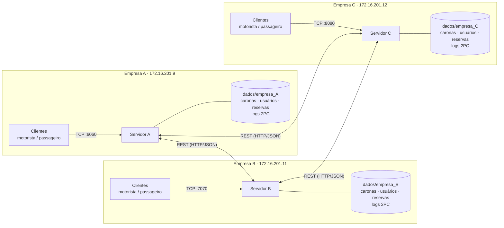
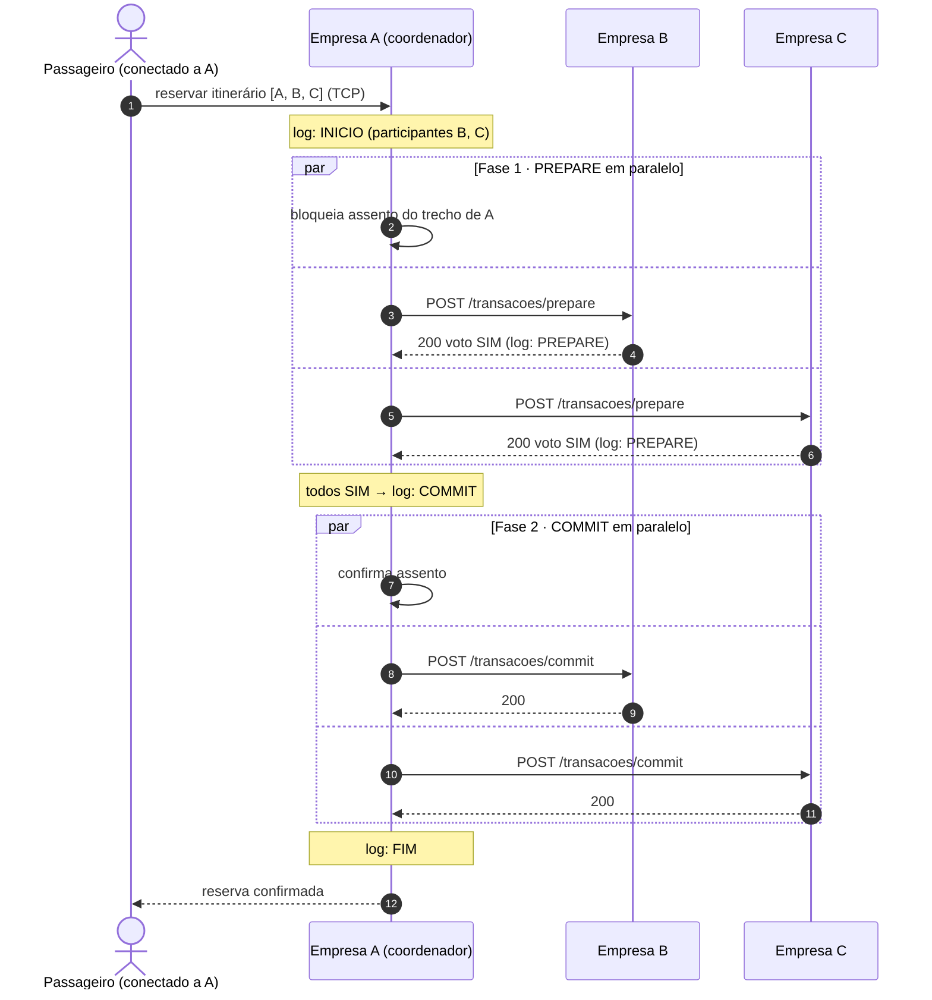
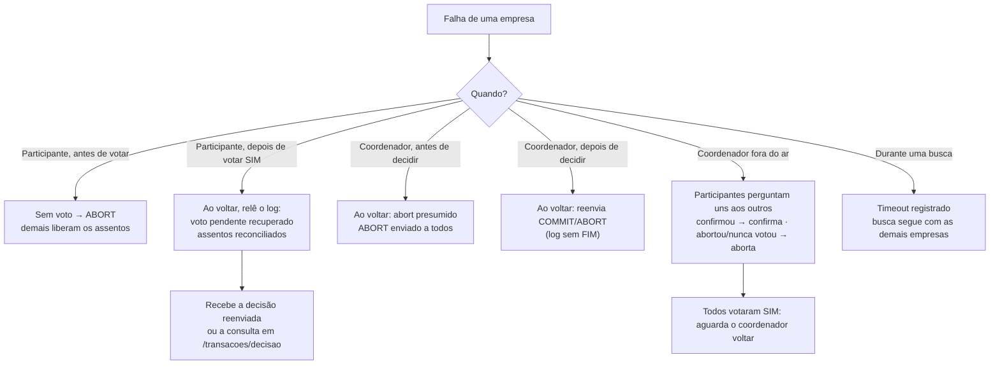

# VaiJunto — Consórcio de Caronas Compartilhadas

> TEC502 — Concorrência e Conectividade · Problema 2 · UEFS

Sistema distribuído em que várias empresas de caronas formam um consórcio. Cada empresa mantém o seu próprio servidor, os seus motoristas, os seus passageiros e a sua estrutura de armazenamento. Um passageiro conectado a **uma** empresa pode pesquisar e reservar itinerários compostos por trechos de caronas de **qualquer** empresa parceira. As reservas são **atômicas** (garantindo que todos os trechos são reservados ou nenhum deles), numa arquitetura totalmente descentralizada: sem servidor central, sem base de dados partilhada e sem coordenador fixo.

## Sumário

1. [Arquitetura](#arquitetura)
2. [Como Funciona](#como-funciona)
3. [Requisitos](#requisitos)
4. [Execução](#execução)
5. [Clientes](#clientes)
6. [API REST Entre Servidores](#api-rest-entre-servidores)
7. [Testes e Simulador](#testes-e-simulador)
8. [Demonstração de Falha](#demonstração-de-falha)
9. [Configuração](#configuração)
10. [Estrutura do Repositório](#estrutura-do-repositório)

## Arquitetura



* Cada empresa armazena **exclusivamente** os seus próprios dados na diretoria `dados/empresa_X/` (ficheiros JSON e logs de transação `WAL`).
* Clientes (motorista e passageiro) comunicam **exclusivamente** com o servidor da sua própria empresa através do protocolo TCP.
* A comunicação inter-servidores é feita **exclusivamente** via API REST (HTTP/JSON), facilitando a passagem por firewalls organizacionais.
* Cada carona pertence a uma única empresa, sendo esta a única gestora e responsável pelos assentos correspondentes.

## Como Funciona

**Pesquisa de Rotas:** O servidor consulta o seu catálogo local e, **em paralelo**, invoca `GET /api/v1/trechos` em cada servidor parceiro. A montagem dos itinerários é realizada através de uma pesquisa em profundidade (DFS) iterando sobre todos os trechos retornados. Caso um parceiro se encontre indisponível (falha de comunicação ou timeout), a falha é registada no log e a pesquisa prossegue normalmente com as empresas restantes.

**Reserva (Two-Phase Commit - 2PC):** O servidor que processa o pedido inicial do cliente assume o papel de coordenador da transação:

1. Regista `INICIO` no log local, contendo a lista de empresas participantes.
2. **Fase 1 (PREPARE):** Solicita a cada detentor de trecho, em paralelo, que adquira o *lock* (*mutex* local) e bloqueie o assento. Cada participante regista o seu voto no log local utilizando `fsync`.
3. Se **todos** os participantes votarem SIM, o coordenador regista `COMMIT` (ponto sem retorno da transação); caso contrário, regista `ABORT`.
4. **Fase 2:** Envia a decisão final a todos, em paralelo. Utiliza reenvios assíncronos (em *background*) caso algum participante não responda.



Se qualquer participante votar NÃO (`409`) ou não responder dentro do tempo limite, o coordenador regista `ABORT` e envia o comando `POST /transacoes/abort` a todos os participantes, que libertam imediatamente os assentos bloqueados.



Detalhes complementares, diagrama de sequência e tabela de falhas podem ser consultados em `docs/two-phase_commit.md`.

| Problema | Mecanismo | 
| ----- | ----- | 
| Atomicidade | 2PC implementado sobre API REST, com Write-Ahead Logging (WAL) persistido em disco por empresa. | 
| Exclusão Mútua | Cada assento pertence a um único dono; o bloqueio ocorre através de um *mutex* local. Pedidos concorrentes para a última vaga são serializados pelo S.O. | 
| Precedência | Vence o primeiro pedido a adquirir o *lock* no servidor proprietário do assento. Não há dependência de relógios físicos. As mensagens propagam relógios lógicos de Lamport apenas para acompanhamento. | 
| Deadlock | Inexistência de esperas circulares. A fase PREPARE nunca bloqueia em espera ativa: se não houver vaga, o pedido é imediatamente rejeitado. | 
| Tolerância a Falhas | Detetada via *timeout*. A transação aborta e as restantes empresas continuam a operar independentemente. | 
| Coordenador Inoperacional | Terminação cooperativa: os participantes interpelam-se mutuamente. Se algum confirmar a transação, todos confirmam; se algum abortar ou nunca tiver votado, todos abortam. | 
| Recuperação e Persistência | Durante a reinicialização, o participante efetua a leitura do log, recupera votos pendentes e reconcilia os estados dos assentos. O coordenador reenvia decisões não entregues ou aplica o aborto presumido. | 

## Requisitos

* Go 1.22+
* Docker e Docker Compose (para executar a emulação de rede do laboratório)
* `make`

## Execução

### 1. Três servidores na mesma máquina (Docker, IPs fixos)

Cria uma rede Docker `172.16.201.0/24` e atribui a cada empresa o seu IP:

| Empresa | IP | TCP (clientes) | REST publicada no host | 
| ----- | ----- | ----- | ----- | 
| A | `172.16.201.9` | 6060 | 9091 | 
| B | `172.16.201.11` | 7070 | 9092 | 
| C | `172.16.201.12` | 8080 | 9093 | 

```bash
make up-local        # sobe A, B e C
make logs            # acompanha os logs
make down-local      # derruba tudo
```

Verifique se os servidores comunicam entre si:

```bash
docker exec vaijunto-empresa-a wget -qO- http://172.16.201.11:9090/api/v1/trechos
```

### 2. Um servidor por computador (Laboratório)

Em cada computador, inicie **somente** o respetivo servidor. Os IPs das empresas estão em `docker/docker-compose.yaml` (`URL_A`, `URL_B`, `URL_C`). Para usar outros IPs, exporte as variáveis de ambiente:

```bash
export URL_A=http://IP_DO_A:9091
export URL_B=http://IP_DO_B:9092
export URL_C=http://IP_DO_C:9093

make servidor-a      # no computador da empresa A
make servidor-b      # no computador da empresa B
make servidor-c      # no computador da empresa C
```

**Nota:** Liberte as portas **9091–9093** (REST) e a porta TCP de cada empresa na firewall local. Teste o acesso de outro computador:

```bash
curl http://IP_DO_B:9092/api/v1/trechos
```

### 3. Sem Docker

```bash
make run-servidor-a IP_B=<ip> IP_C=<ip>
make run-servidor-b IP_A=<ip> IP_C=<ip>
make run-servidor-c IP_A=<ip> IP_B=<ip>
```

Se não fornecer IPs, os alvos adotam os padrões do `Makefile`.

### Limpar Dados

```bash
make clean-data
```

## Clientes

Cada cliente conecta ao servidor da respetiva empresa:

```bash
make cliente-motorista-a    make cliente-passageiro-a
make cliente-motorista-b    make cliente-passageiro-b
make cliente-motorista-c    make cliente-passageiro-c
```

**Fluxo básico:** Registe um motorista na empresa A e publique uma carona. Registe um passageiro na empresa C e pesquise por itinerários (as rotas das empresas A, B e C aparecem integradas). Reserve uma rota inter-empresas e valide a persistência em `dados/empresa_*`.

## API REST Entre Servidores

Prefixo base: `/api/v1`. Comunicação estabelecida através de JSON.

| Método | Rota | Função | Códigos | 
| ----- | ----- | ----- | ----- | 
| GET | `/trechos?origem=&destino=` | Consulta de trechos com assentos livres | 200 | 
| POST | `/transacoes/prepare` | Fase 1 do 2PC (bloqueio local) | 200 (SIM) · 409 (NÃO) · 400 · 500 | 
| POST | `/transacoes/commit` | Fase 2: confirmação definitiva | 200 · 404 · 409 · 500 | 
| POST | `/transacoes/abort` | Fase 2: cancelamento e libertação | 200 · 409 · 500 | 
| GET | `/transacoes/decisao?tx_id=` | Consulta da decisão final ao coordenador | 200 · 400 | 
| GET | `/transacoes/estado?tx_id=` | Consulta de estado entre participantes (terminação cooperativa) | 200 · 400 | 
| POST | `/trechos/cancelar` | Liberta um trecho previamente confirmado | 200 · 404 | 
| POST | `/sync/status` | Reconciliação (anti-entropia) no reinício | 200 | 
| POST | `/caronas/cancelada` | Notificação de cancelamento de carona | 200 | 

Os métodos `prepare`, `commit` e `abort` são desenhados para serem puramente idempotentes. Especificação completa em `docs/two-phase_commit.md`.

## Testes e Simulador

### Testes Automatizados

```bash
make test                                  # ou: go test ./tests/ -count=1 -v
go test ./tests/ -race -count=5            # com detector de concorrência
```

O projeto implementa rigorosos testes de integração e falhas, emulando ciclos reais de queda e reinício:

* Verificação atómica entre três instâncias, garantindo a inexistência de reservas parciais.
* Stress de exclusão mútua: 30 pedidos paralelos ao último assento originando apenas 1 confirmação.
* Injeção de transações cruzadas em ordens inversas provando a ausência de *deadlocks*.
* Sobrecarga de 300 reservas concorrentes sem corrupção de estado (duplicações ou perdas de vagas).
* Testes exaustivos do mecanismo de recuperação (Fase 1 incompleta, coordenador inativo, órfãos de *lock*).

### Teste Ponta a Ponta (Processos Reais)

```bash
go build -o bin/servidor ./aplicacao/servidor
python3 tests/e2e/cancelamento.py ./bin/servidor
```

Sobe A, B e C em `localhost`, injeta cancelamentos e derruba empresas abruptamente, verificando a consistência dos assentos e o reenvio das notificações pendentes.

### Simulador CLI

Gera intensas cargas de pedidos e auditorias constantes à invariante matemática central: `passageiros_alocados + assentos_livres == assentos_totais`.

```bash
make up-local
make simulador COMPOSE="docker compose -f docker/docker-compose.yaml -f docker/docker-compose.local-ips.yaml"
```

Cenários: `contencao`, `cancelamento`, `motorista`, `busca` e `misto`.
Pode isolar um cenário específico, por exemplo:

```bash
make simulador-contencao COMPOSE="docker compose -f docker/docker-compose.yaml -f docker/docker-compose.local-ips.yaml"
```

## Demonstração de Falha

Com os servidores online (`make up-local`):

```bash
docker stop vaijunto-empresa-b       # Interrompe o processo da empresa B

# No passageiro de A ou C:
#   - itinerários que dependem de B são recusados (ABORT) e os assentos em A e C libertados
#   - itinerários exclusivos de A e C continuam a ser processados

docker start vaijunto-empresa-b      # B reinicia e recupera o estado através do log
```

Consulte os logs da transação em `dados/empresa_X/participante.log` e `coordenador.log`.

## Configuração

Variáveis de ambiente (ou flags) aceites pelo servidor:

| Variável | Flag | Padrão | Descrição | 
| ----- | ----- | ----- | ----- | 
| `EMPRESA` | `-empresa` | `VAIJUNTO` | Nome da empresa no consórcio | 
| `TCP_ADDR` | `-tcp` | `:8081` | Endereço TCP dos clientes | 
| `HTTP_ADDR` | `-http` | `:8080` | Endereço da API REST entre servidores | 
| `PARES` | `-pares` | vazio | `B=http://host:porta,C=http://host:porta` | 
| `DADOS_DIR` | `-dados` | `dados` | Diretoria de armazenamento persistente | 
| `TTL_BLOQUEIO` | `-ttl-bloqueio` | `30s` | Tempo até participante pendente consultar o coordenador | 
| `TIMEOUT_PAR` | `-timeout-par` | `3s` | Timeout máximo para chamadas HTTP inter-servidores | 

## Estrutura do Repositório

```text
aplicacao/
  servidor/        servidor de empresa (TCP clientes + REST parceiros)
  motorista/       cliente do motorista
  passageiro/      cliente do passageiro
  simulador/       simulador de carga e auditor de invariantes
componentes/
  distribuido/     coordenador e participante do 2PC, log (WAL), relógio de Lamport
  rest/            handlers e cliente da API REST entre servidores
  servicos/        caronas, reservas, usuários, persistência, busca de itinerários
  modelos/         estruturas de dados partilhadas
  cliente_servidor/ protocolo TCP entre clientes e servidor
docker/            Dockerfile e docker-compose (normal e com IPs fixos)
docs/              especificação, 2PC e diagramas
tests/             testes automatizados (carga, concorrência, falhas)
```