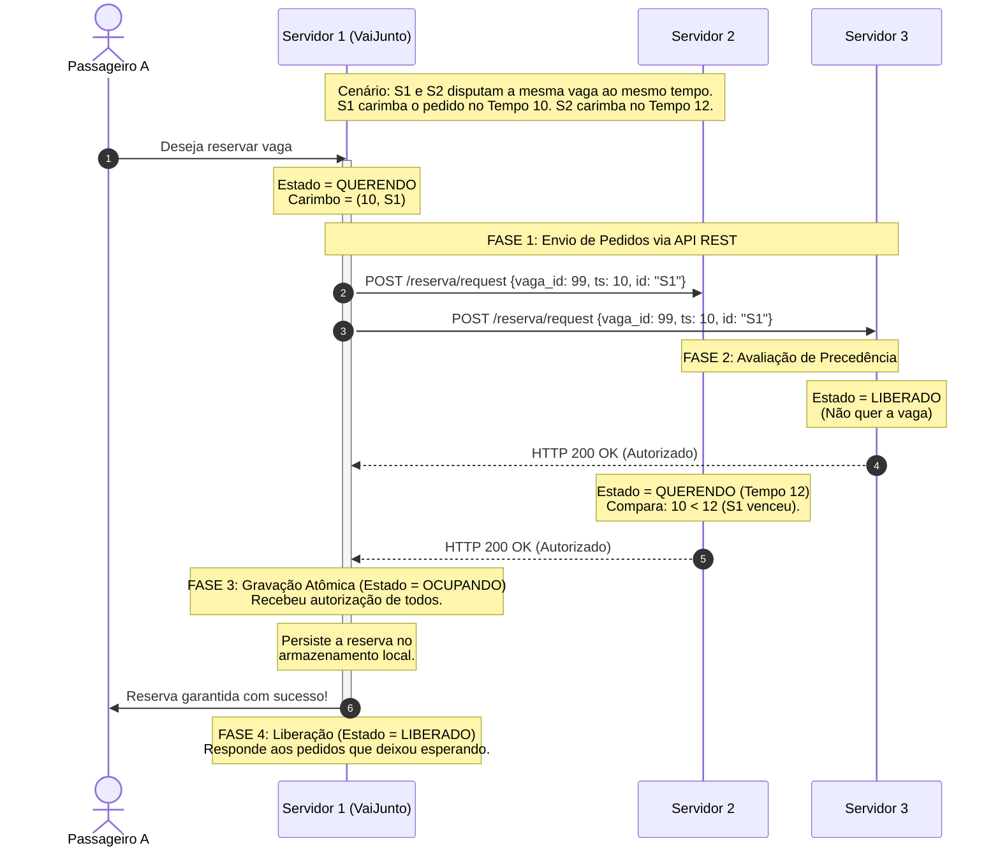

# Coordenação Distribuída: Algoritmo de Ricart-Agrawala aplicado ao VaiJunto

> **Atenção:** este algoritmo foi estudado como alternativa, mas **não está ligado ao servidor**. A exclusão mútua adotada é a serialização no dono do assento; veja `two-phase_commit.md`.

> **TEC502 - TP02 - Concorrência e Conectividade — Semestre 2026.2 | UEFS**

## 1. Objetivo

Este algoritmo baseia-se em troca de mensagens e **relógios lógicos** para garantir de forma justa que duas empresas não reservem o mesmo assento simultaneamente.

## 2. Como o Algoritmo Funciona

Imagine o consórcio como um grupo de empresas que compartilham uma regra de convivência. Quando um passageiro tenta reservar uma carona que possui alta concorrência, o servidor onde ele está conectado precisa "entrar na fila" e pedir autorização para os vizinhos.

### Os 3 Estados de um Servidor
Para cada assento/carona em disputa, um servidor pode estar em um destes três estados:
* **LIBERADO (Released):** O servidor não tem nenhum passageiro tentando reservar aquela carona no momento.
* **QUERENDO (Wanted):** O servidor tem um passageiro tentando reservar e está coletando votos.
* **OCUPANDO (Held):** O servidor conseguiu a autorização de todos, entrou na seção crítica e está gravando a reserva.

## 3. O Passo a Passo no Consórcio

### Passo 1: O Pedido de Reserva (Entrando na Fila)
Quando o Passageiro A clica em "Reservar" no **Servidor 1 (VaiJunto)**:
1. O Servidor 1 muda seu estado interno para **QUERENDO**.
2. Ele incrementa seu **Relógio Lógico** (ex: o relógio vira `10`).
3. Ele envia uma requisição via **API REST** (`POST /reserva/request`) para **todos** os outros servidores do consórcio (Servidor 2 e Servidor 3), dizendo: *"Quero travar essa vaga. Meu carimbo de tempo é (10, Servidor 1)"*.

### Passo 2: A Avaliação dos Vizinhos (Quem tem prioridade?)
Quando o **Servidor 2** recebe o pedido do Servidor 1, ele analisa sua própria situação para aquela vaga:
* **Se o Servidor 2 estiver LIBERADO:** Ele não quer a vaga. Ele responde imediatamente com um **`HTTP 200 OK (REPLY)`**.
* **Se o Servidor 2 estiver OCUPANDO:** Ele já está gravando a reserva de outro passageiro. Ele **ignora e guarda** o pedido do Servidor 1 em uma fila interna para responder depois.
* **Se o Servidor 2 também estiver QUERENDO (Concorrência Direta):** Ele compara os carimbos de tempo. Suponha que o Servidor 2 pediu no tempo `12`.
    * Como `10` veio antes de `12`, o Servidor 1 tem prioridade. O Servidor 2 aceita a derrota e responde **`HTTP 200 OK (REPLY)`**.
    * Se o Servidor 2 tivesse pedido no tempo `08`, ele teria prioridade. Então, ele guardaria o pedido do Servidor 1 e ficaria em silêncio.

### Passo 3: Confirmação e Liberação
* O **Servidor 1** só confirma a vaga para o Passageiro A quando recebe o `HTTP 200 OK` de **todos** os servidores ativos do consórcio.
* Após gravar no seu banco de dados local (**OCUPANDO**), ele muda para **LIBERADO** e responde a todas as requisições que ele tinha guardado na fila durante o processo.

---

## 4. Diagrama de Fluxo

O diagrama abaixo ilustra o cenário de concorrência onde o **Servidor 1** ganha a disputa do **Servidor 2** por ter feito o pedido um instante antes (Tempo 10 vs Tempo 12).

---

## 5. Restrições para o Problema

O uso do Ricart-Agrawala resolve de forma nativa os desafios impostos pela especificação:

1. **Sem Relógios Sincronizados (Requisito 6):** O desempate usa os Relógios Lógicos (Timestamps). Se houver empate no tempo lógico (ex: ambos geram tempo `10`), o identificador determinístico do servidor desempata (ex: `"S1"` < `"S2"`).
2. **Comunicação por API REST (Requisito 4 e 10):** As mensagens de `REQUEST` e `REPLY` são mapeadas em rotas HTTP estruturadas executadas entre os contêineres Docker.
3. **Adaptação para Tolerância a Falhas (Requisito 7):** O algoritmo original de Ricart-Agrawala trava se um nó cair, pois ele exige a resposta de *todos*. Para contornar isso e atender ao requisito do TP02, o sistema implementa **Timeouts HTTP**. Se o Servidor 3 não responder dentro do prazo, ele é detectado como indisponível e o Servidor 1 prossegue a reserva com segurança, assumindo o voto correspondente.
