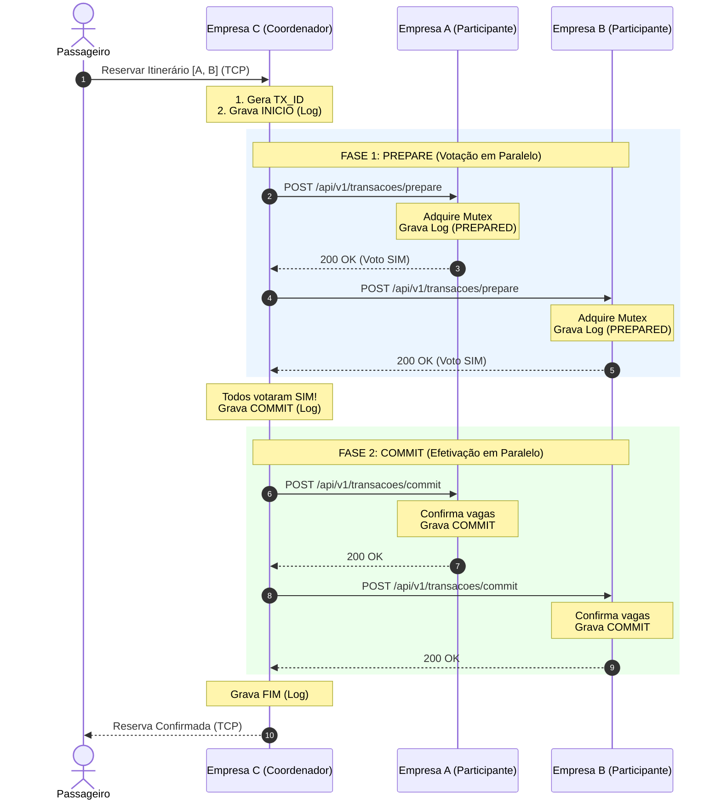
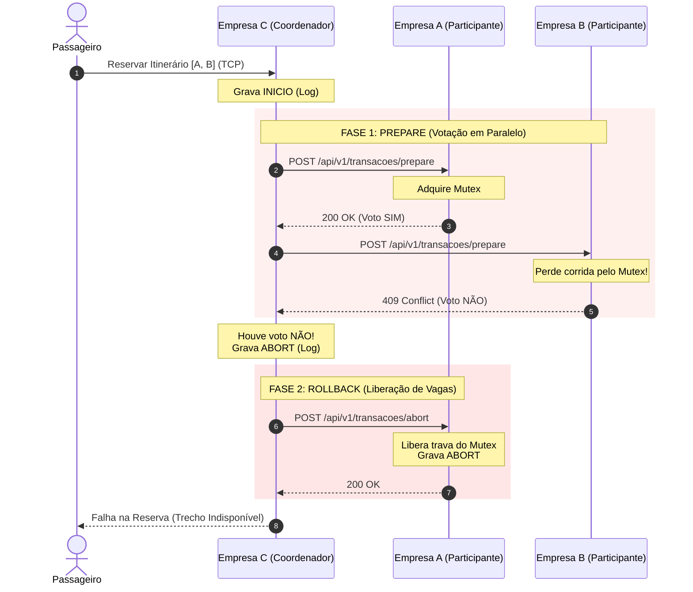
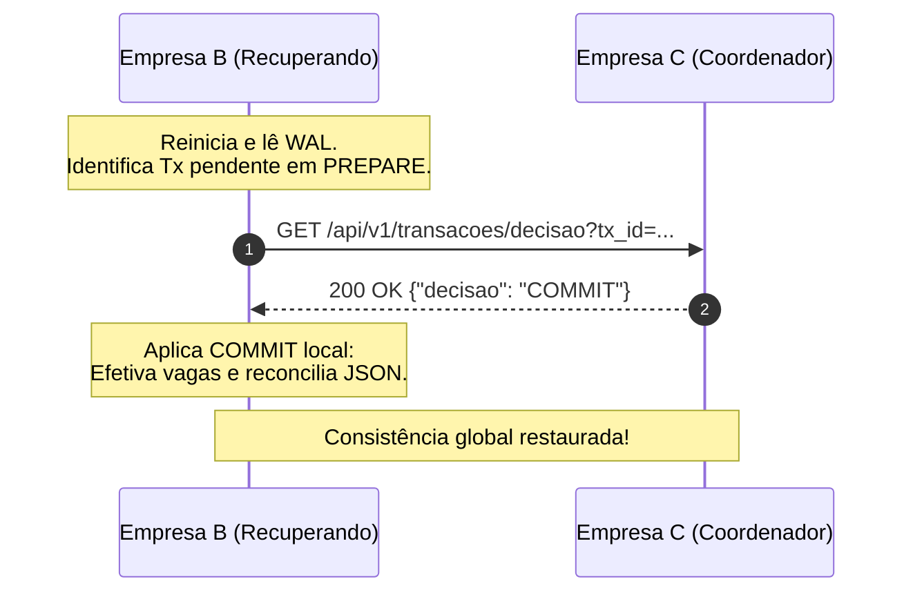

# Documentação da API REST Interna entre os Servidores do Consórcio

Este documento descreve a especificação formal da API REST exposta e consumida exclusivamente pelos servidores dos membros do consórcio VaiJunto (ex.: `Empresa_A`, `Empresa_B`, `Empresa_C`).

A comunicação com os clientes (motorista e passageiro) ocorre via protocolo de aplicação sobre TCP persistente, conectando-se cada cliente exclusivamente ao servidor da sua empresa de origem. A cooperação entre as empresas para busca consolidada, reserva atômica distribuída (Two-Phase Commit - 2PC), cancelamento com devolução de assentos e recuperação de transações é integralmente realizada através dos endpoints REST descritos a seguir.

---

## 1. Convenções Gerais

- **Protocolo e Formato**: Todas as requisições e respostas utilizam HTTP/1.1 com corpos formatados em JSON (`application/json; charset=utf-8`).
- **Prefixo dos Recursos**: Todos os endpoints inter-servidores encontram-se sob o prefixo `/api/v1/` para padronização e regras de firewall corporativo.
- **Identificadores Únicos Universais**:
  - **Caronas**: `{EMPRESA_ID}_CARONA_{NNNN}`. O prefixo garante ausência de colisões entre os catálogos dos diferentes parceiros.
  - **Transações Distribuídas**: `{COORDENADOR_ID}_TX_{UUID}`, geradas pelo nó que coordena a reserva no momento em que o passageiro submete o pedido.
- **Timeouts e Resiliência**: Qualquer chamada sem resposta em 3 segundos é tratada como falha pelo sistema, acionando mecanismos de aborto ou reenvio em *background*. As chamadas do 2PC são idempotentes, apoiadas em logs (WAL) com `fsync`.

### Formato de Erro Padronizado
Em caso de requisições inválidas, falhas de validação ou recusa de votos durante a coordenação, o servidor responde com um envelope padronizado:
```json
{
  "codigo": "SEM_VAGAS",
  "mensagem": "Não há assentos suficientes no trecho solicitado."
}
```

---

## 2. Precedência e Exclusão Mútua

Conforme os requisitos do consórcio, os relógios físicos dos servidores não são sincronizados e as mensagens de rede estão sujeitas a atrasos.

Para solucionar disputas simultâneas pelo último assento de um mesmo trecho entre passageiros conectados a empresas distintas, o VaiJunto adota a seguinte estratégia:

1. **Acompanhamento (Relógio de Lamport)**: As mensagens trocadas carregam um relógio lógico de Lamport para acompanhamento causal, mas ele **não** é o fator de decisão para o desempate.
2. **Exclusão Mútua Física (Mutex Local)**: O critério absoluto de precedência é a corrida pelo lock local (mutex) no servidor que é dono do assento.
3. **Desempate Determinístico**: Vence a transação que atingir o servidor proprietário e adquirir a trava primeiro. Qualquer pedido concorrente que chegue enquanto a trava estiver retida para a primeira transação (ou após as vagas esgotarem) recebe imediatamente um voto de recusa (`VOTE_ABORT` / HTTP 409). O PREPARE nunca espera bloqueado.

---

## 3. Especificação dos Recursos da API

### 3.1. GET `/api/v1/trechos`

Consulta as caronas registradas no catálogo local do servidor parceiro. Utilizado em tempo real para a montagem de itinerários por busca em profundidade (DFS). Retorna apenas trechos com assento livre.

- **Método**: `GET`
- **Query Params**:
  - `origem` *(opcional)*: Filtra pela cidade de origem.
  - `destino` *(opcional)*: Filtra pela cidade de destino.

#### Resposta de Sucesso (HTTP 200 OK)
```json
{
  "trechos": [
    {
      "id_trecho": "EMPRESA_A_TRECHO_102",
      "id_carona": "EMPRESA_A_CARONA_001",
      "empresa": "Empresa_A",
      "origem": "Salvador",
      "destino": "Feira de Santana",
      "data_hora": "2026-11-15T08:00:00Z",
      "assentos_livres": 3,
      "preco": 35.00
    }
  ]
}
```

---

### 3.2. POST `/api/v1/transacoes/prepare`

Executa a **Fase 1 do Two-Phase Commit (2PC)**. O coordenador envia o pedido de bloqueio aos participantes. O participante verifica os trechos da sua empresa, adquire o mutex local e tenta efetuar o bloqueio provisório das vagas na memória, gravando o voto no log (WAL).

- **Método**: `POST`
- **Idempotência**: Sim. Chamadas repetidas com o mesmo `tx_id` não deduzem assentos extras.

#### Corpo da Requisição (Payload)
```json
{
  "tx_id": "Empresa_C_TX_1730000000",
  "coordenador": "Empresa_C",
  "lamport_time": 42,
  "trechos": [
    {
      "id_trecho": "EMPRESA_A_TRECHO_102",
      "assentos_necessarios": 1
    }
  ]
}
```

#### Resposta de Voto Favorável (HTTP 200 OK)
```json
{
  "status": "VOTE_COMMIT",
  "mensagem": "Assento bloqueado e preparado para confirmação."
}
```

#### Resposta de Voto Contrário (HTTP 409 Conflict)
```json
{
  "status": "VOTE_ABORT",
  "codigo": "SEM_VAGAS_OU_LOCK_OCUPADO",
  "mensagem": "Vagas esgotadas ou recurso retido por outra transação."
}
```

---

### 3.3. POST `/api/v1/transacoes/commit`

Executa a **Fase 2 do 2PC (Confirmação)**. O participante efetiva a reserva das vagas travadas na Fase 1, remove a pendência do seu log e persiste o estado das caronas em JSON.

- **Método**: `POST`
- **Idempotência**: Sim. Reexecuções garantem o sucesso sem efeitos colaterais.

#### Corpo da Requisição (Payload)
```json
{
  "tx_id": "Empresa_C_TX_1730000000",
  "coordenador": "Empresa_C"
}
```

#### Resposta de Sucesso (HTTP 200 OK)
```json
{
  "status": "SUCCESS",
  "mensagem": "Commit efetivado com sucesso."
}
```

---

### 3.4. POST `/api/v1/transacoes/abort`

Executa a **Fase 2 do 2PC (Cancelamento/Rollback)**. Notifica o participante de que a transação falhou globalmente. O participante desfaz o bloqueio provisório, devolve os assentos e marca a transação como abortada.

- **Método**: `POST`
- **Idempotência**: Sim. Se a transação já foi abortada ou não existe, retorna sucesso seguro.

#### Corpo da Requisição (Payload)
```json
{
  "tx_id": "Empresa_C_TX_1730000000",
  "coordenador": "Empresa_C"
}
```

#### Resposta de Sucesso (HTTP 200 OK)
```json
{
  "status": "SUCCESS",
  "mensagem": "Abort efetivado e assentos liberados."
}
```

---

### 3.5. GET `/api/v1/transacoes/decisao`

Mecanismo para o **Protocolo de Recuperação Pós-Queda**. Quando um nó participante reinicia e encontra transações no estado `PREPARE` em seu log (`WAL`), ele consulta o coordenador para descobrir o desfecho.

- **Método**: `GET`
- **Query Params**: `tx_id` *(obrigatório)*

#### Resposta de Sucesso (HTTP 200 OK)
```json
{
  "tx_id": "Empresa_C_TX_1730000000",
  "decisao": "COMMIT",
  "coordenador": "Empresa_C"
}
```

---

### 3.6. GET `/api/v1/transacoes/estado`

Mecanismo de **Terminação Cooperativa**. Caso o coordenador esteja inoperacional (falha), os participantes interpelam-se mutuamente para descobrir se algum deles já recebeu a decisão final.

- **Método**: `GET`
- **Query Params**: `tx_id` *(obrigatório)*

#### Resposta de Sucesso (HTTP 200 OK)
```json
{
  "tx_id": "Empresa_C_TX_1730000000",
  "estado_local": "COMMITTED"
}
```
*(Estados possíveis: `PREPARED`, `COMMITTED`, `ABORTED`, `UNKNOWN`)*

---

### 3.7. Operações de Cancelamento e Sincronização

- **`POST /api/v1/trechos/cancelar`**: Devolve assentos de um trecho já confirmado previamente (cancelamento voluntário do passageiro). Idempotente.
- **`POST /api/v1/caronas/cancelada`**: Notifica o cancelamento integral de uma carona publicada.
- **`POST /api/v1/sync/status`**: Endpoint de reconciliação de estado. Processa avisos retidos em filas no disco enquanto uma empresa esteve fora do ar.

---

## 4. Tabela de Códigos de Retorno HTTP e da Aplicação

| HTTP Status | `codigo` da Aplicação | Significado no Protocolo |
|---|---|---|
| **200 OK** | — | Sucesso na operação, repetição idempotente ou voto favorável `VOTE_COMMIT`. |
| **400 Bad Request** | `PAYLOAD_INVALIDO` | Corpo JSON malformado ou parâmetros ausentes. |
| **404 Not Found** | `NAO_ENCONTRADO` | Recurso desconhecido ou trecho já liberado. |
| **409 Conflict** | `SEM_VAGAS` | Voto `VOTE_ABORT`: Assentos esgotados no trecho. |
| **409 Conflict** | `LOCK_RETIDO` | Voto `VOTE_ABORT`: Concorrência simultânea, perdeu a corrida pelo mutex local. |
| **500 Internal Error** | `ERRO_PERSISTENCIA` | Falha ao persistir estado em disco (`fsync` falhou). |

---

## 5. Diagramas de Sequência da Confirmação de Itinerário

### 5.1. Cenário 1: Confirmação com Sucesso (Global Commit)

O passageiro está conectado à **Empresa C** (que atua como Coordenador). O itinerário combina trechos da **Empresa A** e da **Empresa B**.



### 5.2. Cenário 2: Abort Global por Vagas Esgotadas ou Concorrência

Neste cenário, a **Empresa A** aprova o bloqueio, mas a **Empresa B** rejeita devido a um empate perdido na aquisição do lock ou falta de vagas. O Coordenador C aborta a transação para evitar uma reserva pela metade.



### 5.3. Cenário 3: Protocolo de Recuperação Pós-Queda (Crash Recovery)

A **Empresa B** sofre uma queda de energia após votar SIM e antes de receber a decisão final. Ao reiniciar, ela não deixa o assento preso indefinidamente.

