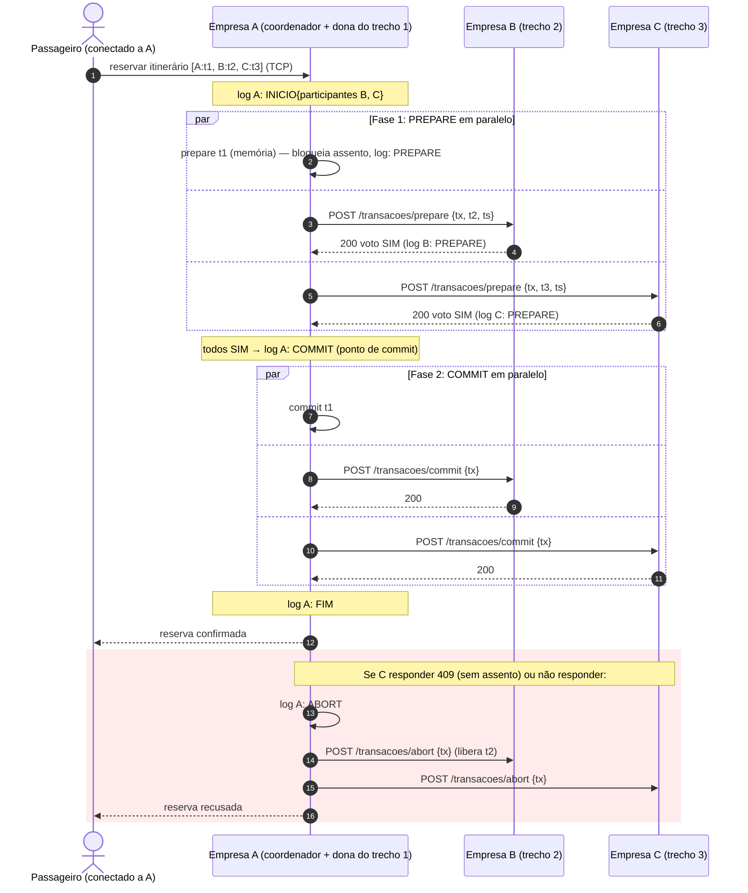

# Atomicidade distribuída: Two-Phase Commit (2PC) sobre API REST

> **TEC502 - TP02 - Concorrência e Conectividade — Semestre 2026.2 | UEFS**

Este documento descreve o que está **implementado** em `componentes/distribuido` e `componentes/rest`.

## 1. Papéis

* **Coordenador:** a empresa que recebeu o pedido do passageiro. Não há coordenador fixo: cada reserva é coordenada pela empresa onde o passageiro está conectado.
* **Participante:** toda empresa dona de pelo menos um trecho do itinerário (inclusive o próprio coordenador, que usa chamada em memória para os seus trechos).
* **Dono do assento:** cada carona pertence a uma única empresa; só ela altera os assentos daquela carona. Isso serializa as disputas por um mesmo assento (ver seção 6).

## 2. Protocolo

1. **INICIO** — o coordenador grava no seu log a lista de participantes e o relógio de Lamport da transação.
2. **Fase 1, PREPARE** — um `POST /transacoes/prepare` por trecho, **em paralelo**. Cada participante bloqueia o assento, grava o voto SIM no seu log (com `fsync`) e responde. Limite de espera: 3 s.
3. **Decisão** — COMMIT somente se **todos** votaram SIM; caso contrário (voto NÃO, timeout, empresa fora do ar) ABORT. A decisão é gravada no log do coordenador **antes** de ser enviada: esse é o ponto de commit da transação.
4. **Fase 2** — `POST /transacoes/commit` ou `/abort` para todos, em paralelo. Quem não responde é re-tentado em segundo plano (`IntervaloReenvioFase2`).
5. **FIM** — quando todos confirmaram a entrega, o coordenador grava FIM.

## 3. API REST entre servidores

Corpo e resposta em JSON. Prefixo: `/api/v1`.

| Método | Rota | Corpo | Respostas |
|---|---|---|---|
| GET | `/trechos?origem=&destino=` | — | `200` lista de trechos com assento livre (pode ser `[]`) |
| POST | `/transacoes/prepare` | `{tx_id, carona_id, origem, destino, passageiro, timestamp, coordenador}` | `200` voto SIM (idempotente) · `409` voto NÃO · `400` corpo inválido · `500` falha ao gravar o log |
| POST | `/transacoes/commit` | `{tx_id}` | `200` confirmado (idempotente) · `404` transação desconhecida · `409` já abortada · `500` falha de log |
| POST | `/transacoes/abort` | `{tx_id}` | `200` abortado (idempotente, inclusive se desconhecida) · `409` já confirmada · `500` falha de log |
| GET | `/transacoes/decisao?tx_id=` | — | `200 {decisao: COMMIT \| ABORT \| EM_ANDAMENTO}` · `400` sem `tx_id` |
| GET | `/transacoes/estado?tx_id=` | — | `200 {estado: PREPARADA \| CONFIRMADA \| ABORTADA \| DESCONHECIDA}` · `400` sem `tx_id`. Entre participantes (terminação cooperativa); perguntar sobre transação nunca vista a registra como ABORTADA |
| POST | `/trechos/cancelar` | `{carona_id, origem, destino, passageiro}` | `200` · `404` passageiro/trecho não encontrado |
| POST | `/sync/status` | `{empresa_solicitante, trechos_ativos[]}` | `200 {trechos_para_liberar[]}` |
| POST | `/caronas/cancelada` | `{empresa, carona_id}` | `200` |

O voto NÃO é `409 Conflict` com corpo `{voto_sim:false, motivo}`; ausência de resposta (timeout, conexão recusada) conta como NÃO.

### Requisição sem resposta e requisição repetida

* **Sem resposta (timeout):** no PREPARE conta como voto NÃO e a transação aborta; na fase 2 o coordenador repete a mensagem até receber resposta, e o participante também pode perguntar sozinho em `GET /transacoes/decisao`.
* **Repetida:** PREPARE repetido (mesmo `tx_id`, trecho e passageiro) não bloqueia um segundo assento; COMMIT e ABORT repetidos devolvem `200` sem efeito adicional. Um PREPARE que chega **depois** do ABORT da mesma transação é recusado (`409`), então um atraso na rede não deixa assento preso.

## 4. Diagrama de sequência da confirmação

## 5. Falhas e recuperação

Cada empresa mantém dois logs append-only com `fsync` por registro: `participante.log` e `coordenador.log`.

| Falha | O que acontece |
|---|---|
| Participante cai **antes** de votar | Não responde ao PREPARE → voto NÃO → ABORT; os demais liberam os assentos. |
| Participante cai **depois** de votar SIM | Ao voltar, relê o log: PREPARE sem decisão vira transação pendente, o assento continua reservado e `ReconciliarAssentos` corrige qualquer divergência entre disco e log. Então recebe o COMMIT/ABORT reenviado ou pergunta a decisão ao coordenador. |
| Coordenador cai **antes** de decidir | Ao voltar, vê INICIO sem decisão e aplica **abort presumido**, enviando ABORT a todos os participantes do log. |
| Coordenador cai **depois** de decidir | Ao voltar, vê COMMIT/ABORT sem FIM e **reenvia** a decisão. |
| Coordenador fica fora do ar | **Terminação cooperativa.** Passado o TTL, o participante que votou SIM pergunta a decisão ao coordenador; se ele não responde, pergunta às **outras empresas participantes** (a lista vai em cada PREPARE): se alguma já **confirmou**, confirma; se alguma **abortou** ou **nunca votou**, aborta (quem nunca votou registra o ABORT ao ser perguntado, então o coordenador jamais poderia ter decidido COMMIT, e um PREPARE atrasado dessa transação é recusado). |
| Coordenador fora do ar e **todos** votaram SIM | Caso irredutível do 2PC: ninguém sabe se houve COMMIT, então ninguém decide sozinho. Os assentos desses trechos ficam bloqueados até o coordenador voltar e reenviar a decisão do log. Afeta só essa transação; as demais caronas seguem operando. |
| Empresa fora do ar na **busca** | A consulta a ela falha por timeout e é registrada; a busca devolve os itinerários possíveis com as demais empresas. |

Ao receber `GET /transacoes/decisao` de uma transação desconhecida, o coordenador responde ABORT (**abort presumido**): se ele não gravou COMMIT, a transação não pode ter sido confirmada.

## 6. Exclusão mútua, precedência e deadlock

* **Exclusão mútua:** um assento só é alterado pelo servidor dono da carona, sob um mutex local. `BloquearAssentoProvisorio` testa e decrementa `AssentosLivres` na mesma seção crítica; dois PREPAREs concorrentes para o último assento são serializados e apenas um recebe SIM. Não é preciso um algoritmo de exclusão mútua entre servidores porque cada recurso tem um único dono.
* **Precedência:** vence quem chega primeiro ao servidor dono do assento. Não depende dos relógios físicos (não sincronizados) nem da ordem em que os pedidos saíram das empresas de origem. Cada mensagem carrega um relógio de Lamport (`timestamp`), que mantém uma ordem causal entre os eventos registrados nos logs e é atualizado em cada recepção (`max(local, recebido)+1`).
* **Deadlock:** o PREPARE **nunca espera** por um assento: se não há vaga, recusa na hora e a transação aborta. Sem espera enquanto se segura um recurso, não há espera circular. A consequência é que, sob contenção, duas reservas cruzadas podem abortar ambas (livelock), exigindo nova tentativa do passageiro, em troca de nunca travar.

### Por que não Ricart-Agrawala

Ricart-Agrawala foi avaliado para a exclusão mútua entre servidores e **descartado**:

* **Não há recurso compartilhado entre os servidores.** Cada assento tem um único dono; a seção crítica já é serializada pelo mutex dele. Pedir permissão às demais empresas não protegeria nada a mais.
* **Piora a disponibilidade.** O algoritmo só entra na seção crítica depois de receber REPLY de **todos** os nós ativos; com uma empresa lenta ou caída, as reservas das outras ficariam esperando, contrariando o requisito de que a falha de uma empresa não pode parar as demais.
* **Custo.** Cada reserva exigiria uma rodada extra de mensagens com todas as empresas, mesmo para trechos de uma só.
* **Deadlock.** Entre vários recursos, o algoritmo introduz espera enquanto se segura uma seção crítica; o PREPARE sem espera evita a espera circular por construção.
